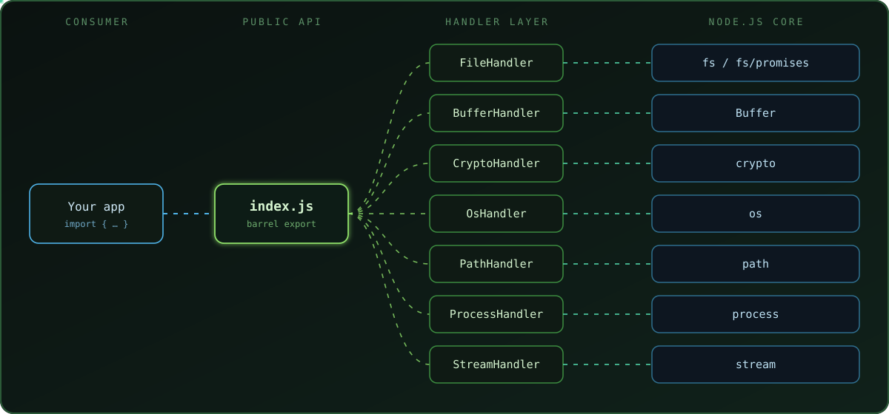
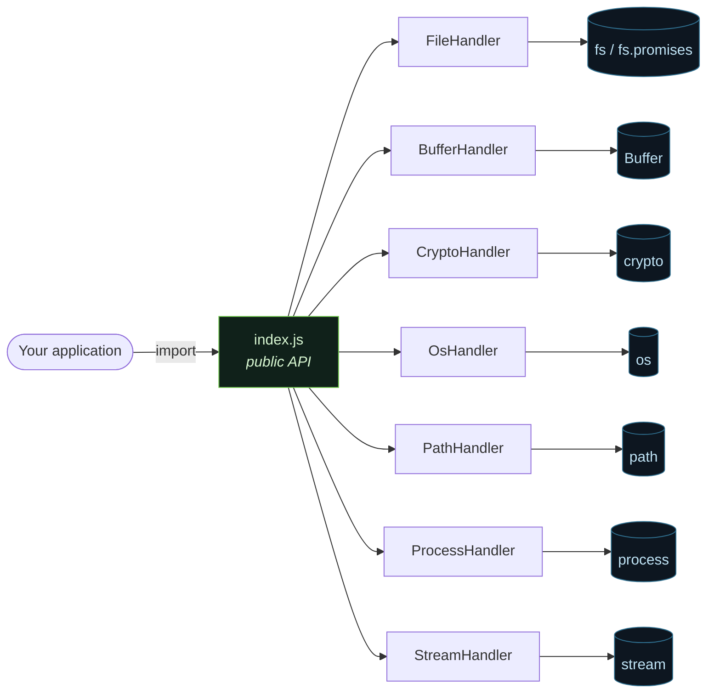

<div align="center">



<br/>

[](https://nodejs.org/)
[](https://nodejs.org/api/esm.html)
[](https://www.npmjs.com/)
[](./LICENSE)
[](#-roadmap)

**A hands-on, engineering-first exploration of Node.js built-in modules —<br/>wrapped in clean, reusable handler classes.**

[Overview](#-overview) · [Architecture](#-architecture) · [Modules](#-modules) · [Quick Start](#-quick-start) · [Usage](#-usage) · [Internals](#-under-the-hood) · [Roadmap](#-roadmap)

</div>


## 🧭 Overview

`nodejs-core-module-handlers` is a toolkit that **encapsulates Node.js core modules behind small, single-purpose handler classes**. Instead of scattering `fs`, `crypto` or `stream` calls across an application, each module gets one dedicated class with a clear responsibility and a consistent interface.

The project has two goals running in parallel:

| 🎓 Learn | 🏗️ Build |
|---|---|
| Understand *how* the Node.js runtime works by using its core APIs directly — no third‑party dependencies hiding the details. | Package that understanding into reusable abstractions, published as a proper **npm package** with a single public entry point. |

> **Philosophy:** zero runtime dependencies, thin abstractions, and code that reads like documentation.


## 🏛️ Architecture

<div align="center">

</div>

<br/>

Every consumer talks to **one** file — `index.js`. It re-exports the handler classes, so internal file layout can change without breaking imports. Each handler owns exactly one Node.js core module.



### Design principles

- **Single responsibility** — one handler ↔ one core module.
- **Single entry point** — `index.js` is the only supported import surface.
- **Zero dependencies** — everything is built on the Node.js standard library.
- **Native ES Modules** — `import` / `export`, no transpilation.
- **Sync *and* async awareness** — each handler makes the difference between blocking and non‑blocking APIs explicit.
- **Transparent wrappers** — abstractions add structure, not magic; you can always read straight through to the underlying API.


## 📚 Modules

| Handler | Wraps | Responsibility | Runtime nature |
|---|---|---|---|
| `FileHandler` | [`fs`](https://nodejs.org/api/fs.html) · `fs/promises` | Files & directories | Async I/O (libuv thread pool) |
| `BufferHandler` | [`Buffer`](https://nodejs.org/api/buffer.html) | Binary data & memory handling | Synchronous, in‑memory |
| `CryptoHandler` | [`crypto`](https://nodejs.org/api/crypto.html) | Hashing, HMAC, encryption / decryption | CPU‑bound (OpenSSL) |
| `OsHandler` | [`os`](https://nodejs.org/api/os.html) | Operating‑system information | Synchronous, read‑only |
| `PathHandler` | [`path`](https://nodejs.org/api/path.html) | Path manipulation & normalisation | Pure string logic |
| `ProcessHandler` | [`process`](https://nodejs.org/api/process.html) | Process info & control | Global runtime object |
| `StreamHandler` | [`stream`](https://nodejs.org/api/stream.html) | Chunked, memory‑efficient data processing | Async, back‑pressure aware |


## ⚡ Quick Start

<div align="center">

</div>

<br/>

**Requirements:** Node.js **18+** and npm.

```bash
git clone https://github.com/MIhajloS07/nodejs-core-module-handlers.git
cd nodejs-core-module-handlers
npm install
npm start
```

### Use it as a package

The package was verified locally by packing it and installing the tarball into a separate project:

```bash
# inside this repository
npm pack                      # → nodejs-core-module-handlers-<version>.tgz

# inside a different Node.js project
npm install ../path/to/nodejs-core-module-handlers-<version>.tgz
```


## 🧩 Usage

Everything is imported from the single entry point:

```js
import {
  FileHandler,
  BufferHandler,
  CryptoHandler,
  OsHandler,
  PathHandler,
  ProcessHandler,
  StreamHandler,
} from "nodejs-core-module-handlers"; // or "./index.js" when working inside the repo
```

Each class is documented in its own file under [`modules/`](./modules). A runnable demonstration lives in [`test/server.js`](./test/server.js).

<details>
<summary><b>📁 Project structure</b></summary>

<br/>

```text
nodejs-core-module-handlers/
├── modules/
│   ├── FileHandler.js        # fs / fs.promises
│   ├── BufferHandler.js      # Buffer
│   ├── CryptoHandler.js      # crypto
│   ├── OsHandler.js          # os
│   ├── PathHandler.js        # path
│   ├── ProcessHandler.js     # process
│   └── StreamHandler.js      # stream
├── test/
│   └── server.js             # demonstration / manual test
├── index.js                  # public API entry point
├── package.json
├── .npmignore                # keeps the published tarball clean
├── LICENSE
└── README.md
```

</details>


## 🔬 Under the hood

Short engineering notes on what each wrapped module actually does inside the runtime. Expand what interests you.

<details>
<summary><b>📄 fs — files, libuv and the thread pool</b></summary>

<br/>

- Most `fs` operations are dispatched to **libuv's thread pool** (default size: 4, configurable via `UV_THREADPOOL_SIZE`), so the event loop stays free while the disk works.
- The callback/promise APIs are **non‑blocking**; the `*Sync` variants **block the event loop** and are best kept to start‑up code and scripts.
- Prefer `fs/promises` with `async/await` for application code.

</details>

<details>
<summary><b>🧱 Buffer — raw memory</b></summary>

<br/>

- `Buffer` is a subclass of `Uint8Array` — a fixed‑size view over raw bytes, allocated outside the regular JS heap.
- It is the common currency of I/O: file reads, sockets and crypto all produce or consume buffers.
- Encoding (`utf8`, `hex`, `base64`, …) only matters at the boundary where bytes become strings.

</details>

<details>
<summary><b>🔐 crypto — OpenSSL bindings</b></summary>

<br/>

- Node's `crypto` is a binding to **OpenSSL**; the heavy lifting happens in native code.
- **Hash** = one‑way digest · **HMAC** = digest keyed with a secret (integrity + authenticity) · **Cipher** = reversible, key‑based encryption.
- Passwords need a purpose‑built KDF (`scrypt`, `pbkdf2`), not a plain hash.

</details>

<details>
<summary><b>🖥️ os & 🛤️ path — environment awareness</b></summary>

<br/>

- `os` reads platform facts (CPU, memory, hostname, EOL, home dir) straight from the operating system.
- `path` is pure string manipulation with two flavours — `path.posix` and `path.win32` — chosen by the host platform. Building paths with `path.join` / `path.resolve` instead of string concatenation keeps code portable between Linux/WSL and Windows.

</details>

<details>
<summary><b>⚙️ process — the running program</b></summary>

<br/>

- `process` is a global exposing PID, arguments, environment variables, memory usage, signals and exit codes.
- It is also an `EventEmitter` — hooks like `exit`, `SIGINT` and `uncaughtException` enable graceful shutdown.

</details>

<details>
<summary><b>🌊 stream — back‑pressure and constant memory</b></summary>

<br/>

- Streams process data **in chunks**, so a multi‑gigabyte file needs only a few kilobytes of memory.
- The four kinds: **Readable**, **Writable**, **Duplex**, **Transform**.
- **Back‑pressure** keeps a fast producer from overwhelming a slow consumer; `pipeline()` wires streams together and handles errors and clean‑up.


</details>


## 🗺️ Roadmap

- [x] `fs` · `Buffer` · `crypto` · `os` · `path` · `process` · `stream` handlers
- [x] Public API via `index.js`
- [x] Local package verification with `npm pack`
- [ ] `events` — `EventEmitter` handler
- [ ] `http` / `https` — server & client handler
- [ ] `child_process` and `worker_threads`
- [ ] `zlib`, `readline`, `url`, `util`
- [ ] Automated test suite with the built‑in `node:test` runner
- [ ] JSDoc / TypeScript declaration files
- [ ] Publish to the npm registry

## 🤝 Contributing

Ideas, issues and pull requests are welcome.

1. Fork the repository
2. Create a branch: `git checkout -b feat/my-handler`
3. Follow the existing pattern — one handler class per core module, exported through `index.js`
4. Open a pull request describing what was added and why

## 📄 License

Distributed under the terms of the [LICENSE](./LICENSE) file.


<div align="center">

**Built by [Mihajlo Stoiljković](https://github.com/MIhajloS07)**

*Learning the runtime by building on top of it.*

⭐ If this repository helped you understand Node.js a bit better, consider giving it a star.

</div>
